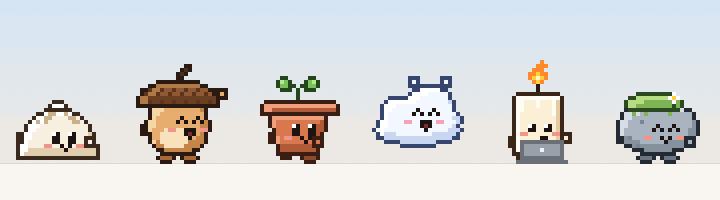

# 커뮤니티 캐릭터

[English](README.md) | 한국어

사람들이 도트 친구용으로 그린 캐릭터예요. 앱에서 펫을 오른쪽 클릭 → 캐릭터 → **다른 캐릭터 받기…** 에서 골라 **받기**를 누르면 캐릭터 메뉴에 바로 생겨요. 목록과 미리보기는 [README.md 의 Gallery](README.md#gallery) 에 있어요.

## 기본 캐릭터

아래 여섯은 앱에 들어 있어서 따로 받지 않아도 돼요. [`charas/chars.py`](../charas/chars.py) 가 코드로 그려요.

<p align="center"></p>

## 내 캐릭터 올리기

1. [CHARACTERS.ko.md](../CHARACTERS.ko.md) 대로 캐릭터 꾸러미를 그려요. 꼭 필요한 건 `idle.png` 하나고, 동작을 더 그릴수록 더 생생해져요.
2. 앱에서 먼저 써 봐요. 폴더를 캐릭터 폴더에 넣고 **캐릭터 다시 불러오기**를 눌러요.
3. 이 레포를 포크해서 `community/<이름>/` 으로 폴더를 넣어요. 이름은 `a-z`, `0-9`, `-` 로 2~32자이고, 기본 캐릭터 이름은 못 써요.
4. 풀 리퀘스트를 열어요. CI 가 꾸러미를 검사하고 앱으로 읽어 봐요. 머지되면 CI 가 미리보기를 그리고 갤러리와 앱 목록에 넣어요.

### chara.json

[원래 키](../CHARACTERS.ko.md#charajson)에 세 가지를 더 넣어요.

```json
{
  "name": "Teacup",
  "names": { "en": "Teacup", "ko": "찻잔" },
  "author": "내-github-아이디",
  "license": "CC-BY-4.0",
  "description": "A little teacup that steams while it waits."
}
```

| 키 | 뜻 |
|---|---|
| `author` | GitHub 아이디(갤러리에 링크로 나와요) |
| `license` | 그림의 라이선스: `CC-BY-4.0`, `CC-BY-SA-4.0`, `CC0-1.0`, `MIT` 중 하나 |
| `description` | 한 줄 소개, 140자 이하(없어도 돼요) |

### 규칙

- **직접 그린 것만.** 게임·애니·영화·브랜드 캐릭터나 남의 그림, 그걸 다시 그린 팬아트는 안 돼요. 기존 캐릭터와 닮은 꾸러미는 닫아요.
- 파일은 `chara.json` 과 `<동작>.png` 만(동작 이름은 [CHARACTERS.ko.md](../CHARACTERS.ko.md)). 다른 파일은 안 돼요.
- 칸 크기는 30×32 도트 이하, 모든 동작이 같은 칸 크기, 동작 하나에 16칸까지.
- 파일 하나 64 KB, 꾸러미 전체 512 KB 까지. 도트 그림은 보통 훨씬 작아요.
- 폭력·선정·혐오 내용은 안 돼요.

풀 리퀘스트 전에 직접 검사해 볼 수 있어요.

```bash
python3 scripts/community.py check                    # 파일 이름·크기·chara.json
python3 scripts/community.py check --app bin/DotBuddy # 앱으로 읽어 보기까지(./build.sh 다음에)
```

그림을 못 그려도 [캐릭터 아이디어](https://github.com/doldoldol21/dot-buddy/issues/new?template=character_idea.yml)를 남기면 누군가 그려 줄 수도 있어요.

## 받기는 이렇게 돌아가요

앱은 **다른 캐릭터 받기…** 를 열 때만 이 레포의 `community/index.json` 을 받아요. 받기를 누르면 목록에 적힌 그 꾸러미 파일(`chara.json` 과 PNG)만 받고, 파일마다 크기와 SHA-256 을 목록과 맞춰 본 뒤 캐릭터 폴더에 넣어요. 꾸러미는 그림과 작은 JSON 뿐이고, 직접 넣은 꾸러미와 같은 로더·같은 제한으로 읽어요.

꾸러미마다 그린 사람이 고른 라이선스(`license` 키)를 따르고, 앱 코드는 MIT 예요.
